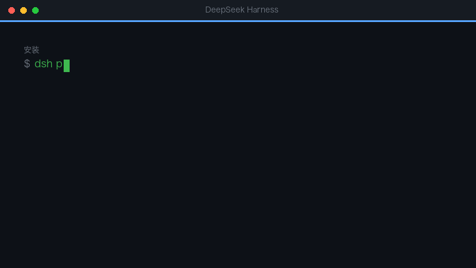

# dsh-repo-watcher（仓库雷达）

> 🐧 **AI 学习群：1132348296**（在 QQ 里搜群号就能加）— 插件怎么做、怎么上架、怎么被更多人看到，群里都有现成答案。



## 三大亮点

1. **有动静就知道** —— 盯住你选的仓库，issue/PR 一有新增或变化就收进 DSH，带未读标记。
2. **GitHub、Gitee 都能盯** —— 设置页「仓库雷达」点点鼠标，或者用 `/watch` 命令：list、add、rm、check；私有仓库配个只读 token 就行。
3. **省额度、零依赖** —— ETag 条件请求，没变化不耗配额；遇到限流自动退避，不装任何依赖、也不用 `gh` CLI。

---

盯住你关心的 GitHub / Gitee 仓库：有人提 issue、发 PR、或状态变了，就在 DSH 里记下来。

**解决的痛点**：让 AI 干活时，你总得切回网页反复刷新看结果。这个插件把「有动静」这件事搬回 DSH——设置页一个未读数，`/watch list` 一句话就能看。

## 安装

```bash
# 装 Release 里的预构建包（当前可用）
dsh plugin --profile desktop add https://github.com/clair0314/dsh-repo-watcher/releases/download/v0.1.0/dsh-repo-watcher-0.1.0.tgz
```

发布到 npm 之后，也可以直接 `dsh plugin --profile desktop add dsh-repo-watcher`。

装完重启 DSH。打开 **设置 → 仓库雷达**。

## 用法

设置页：

1. 输入 `owner/repo`，点「盯住它」。首次抓取只做基线，不会一下冒出几十条未读。
   - Gitee 用 `gitee:owner/repo`，也可以直接把 `https://gitee.com/owner/repo` 粘进来。
2. 之后每 5 / 10 / 30 / 60 分钟检查一次（可在同一页切换）。
3. 有变化时条目变粗、未读数 +1；点「全部标为已读」清空。
4. 「检查」立即拉一次；「移除」不再盯。

命令：

```
/watch               看所有仓库和最新条目
/watch add owner/repo
/watch add gitee:owner/repo
/watch rm owner/repo
/watch check         立即全部检查一次
```

## 配置

| 键 | 说明 | 默认 |
| --- | --- | --- |
| `dataDir` | 状态文件目录（`state.json`） | `~/.dsh/repo-watcher` |
| `token` | GitHub token，提高限额 / 读私有仓库（也可用环境变量 `GITHUB_TOKEN`） | 空（匿名 60 次/小时，只能读公开仓库） |
| `giteeToken` | Gitee 私人令牌，读私有仓库或避免匿名限流（也可用 `GITEE_TOKEN`） | 空（匿名可读公开仓库） |

匿名限额下，盯 3 个仓库 × 10 分钟一次大约每小时 18 次请求，够用；仓库多或想更快，配一个只读 token。

**私有仓库**：GitHub 配一个带 `repo` 只读权限的 token；Gitee 在「设置 → 私人令牌」生成一个勾了 `projects` 的令牌，填到 `giteeToken`（或环境变量 `GITEE_TOKEN`）。插件只读 issue / PR 元数据。

`cordis.patch.yml` 里可写：

```yaml
- insert:
    - id: dsh-repo-watcher
      name: 'dsh-repo-watcher'
      config:
        dataDir: /Users/you/.dsh/repo-watcher
```

## 数据与隐私

- 只读取仓库的 issue / PR 元数据（标题、编号、作者、状态、更新时间、链接）。
- 不改仓库、不发评论、不读代码内容。
- token 只存在本机配置文件或环境变量里，不会发往 GitHub / Gitee 以外的地方。
- 状态全部落在 `dataDir/state.json`，删掉即清空。

## 开发

```bash
node test/selftest.mjs   # 无依赖，stub ctx + 假 fetch
```

结构：

- `lib/index.js` — host 半边：轮询 GitHub / Gitee、`/repo-watcher/api/*` 路由、`/watch` 命令。
- `lib/client.js` — 浏览器半边：设置页（lazy-CJS，由 shell 的 `__ModuleLoader__` 执行）。
- `cordis.patch.yml` — 声明插入的插件 entry。

## 已知边界

- 首次添加不会补历史未读（基线语义）。
- 只盯 issue / PR，不看 commit、release、star。
- GitHub 限流时会在页面上写明恢复时间，不会静默失败；Gitee 限流只给一句提示。
- Gitee 的 issue 编号是字符串（如 `#IBY7QA`），不是数字；PR 走单独的 `/pulls` 端点，拉不到时只显示 issue。
- 「主动弹窗提醒」不在本版范围内；需要的话可以配 `dsh-notify-me` 一起用。

## License

MIT
